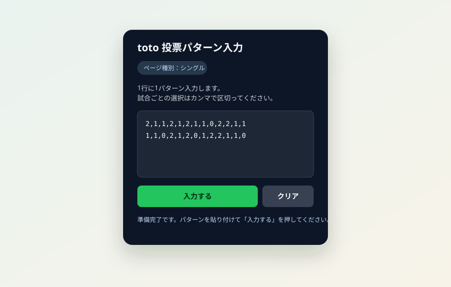

# toto 投票パターン入力サポート

totoの投票パターンを、対応ページの入力欄へまとめて反映する補助ツールです。Userscript版（Tampermonkeyなど）と、Chrome拡張版を用意しています。

このツールは入力欄を操作するだけです。購入内容を確認し、購入手続きは公式サイト上でご自身で行ってください。



## 機能

- 1行に1パターン、試合ごとの選択をカンマ区切りで入力
- シングルページでは、入力した各行を投票欄へ順番に反映
- マルチページでは、先頭行を反映
- 入力欄の選択状態をまとめてクリア
- 対応ページを開いたときだけパネルを表示

入力値には `0`、`1`、`2` を使用します。1試合に複数の選択肢を指定するときは、例のように `12` と続けて入力できます。

```text
2,1,1,2,1,2,1,1,0,2,2,1,1
1,1,0,2,1,2,0,1,2,2,1,1,0
```

行の数や各行の項目数がページ上の投票欄と異なる場合、画面に表示される結果を確認してください。選択肢の対応は公式サイトの表示と照らし合わせ、購入前に必ず入力内容を確認してください。

## Userscript版

1. Tampermonkeyなどのユーザースクリプト管理拡張をChromeにインストールします。
2. このリポジトリの [`toto-autofill.user.js`](toto-autofill.user.js) を開き、スクリプト管理拡張に追加します。
3. 対応するtotoの投票ページを開き、表示されたパネルにパターンを入力します。

更新時は、管理拡張に表示される更新通知またはリポジトリの最新版を利用してください。

## Chrome拡張版

1. リポジトリをダウンロードし、ZIPの場合は展開します。
2. Chromeで `chrome://extensions` を開きます。
3. 「デベロッパーモード」を有効にして「パッケージ化されていない拡張機能を読み込む」を選びます。
4. リポジトリ内の `chrome-extension` フォルダーを選びます。
5. 対応するtotoの投票ページを開きます。

Chrome拡張版はページ上に入力パネルを表示します。拡張機能のポップアップ画面はありません。

Chrome拡張フォルダーは単体で読み込めるようにスクリプトを同梱しています。スクリプトを変更した場合は、ルートの `toto-autofill.user.js` と `chrome-extension/toto-autofill.user.js` の両方を同じ内容に更新してください。

## 対応ページ

- シングル購入の投票ページ
- マルチ購入の投票ページ

対象URLは `chrome-extension/manifest.json` とUserscriptのメタデータに記載しています。

## プライバシー

入力内容を外部サーバーへ送信したり、保存したりする処理はありません。投票ページ上の入力欄をブラウザー内で操作します。
